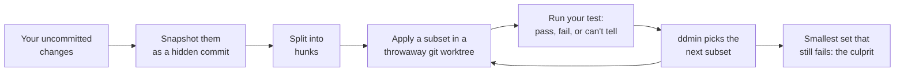

# whodunit

[](https://github.com/sithija-jayasinghe/whodunit/actions/workflows/ci.yml)
[](https://www.npmjs.com/package/whodunit)
[](package.json)
[](package.json)
[](LICENSE)

**Find which change broke your test — and prove it.**

An AI agent just edited a dozen files. A test that passed is now red. Instead of
reading a diff you did not write, run one command:

```bash
npx whodunit -- npm test auth.test.ts
```

whodunit splits your uncommitted changes into individual hunks and runs your
test against subsets of them until it isolates the smallest set that still
breaks it. It does not guess. It has watched the test pass without the
culprit and fail with it.


A real recording of a real search, on the fixture that
[`test/make-fixture.sh`](test/make-fixture.sh) builds: 37 changes across 12
edited files and one new one, and a single broken line. Re-record it with `npm run demo`.

- **Proof, not a guess.** Every answer is backed by test runs you can see.
- **Safe.** It works in a throwaway copy. Your files are never touched, even if you press Ctrl+C.
- **Built for agents.** A built-in [MCP](https://modelcontextprotocol.io) server lets Claude Code and other agents run it on their own changes.
- **Any language.** It only needs a test command that exits 0 when things are fine.
- **Zero runtime dependencies.** TypeScript on Node and Git, nothing else.

## Contents

- [Why](#why)
- [How it works](#how-it-works)
- [Quick start](#quick-start)
- [Use it from an AI agent](#use-it-from-an-ai-agent)
- [Real tests are messy](#real-tests-are-messy)
- [Reference](#reference)
- [Under the hood](#under-the-hood)
- [Known limits](#known-limits)

## Why

Coding agents make large edits fast. When one of those edits breaks a test,
you have three options, and two are bad:

| Option | Problem |
|---|---|
| Undo the whole change (rewind) | Throws away the good edits with the bad one, and never tells you what was wrong. |
| Read the diff, or ask an AI to | A guess. Sometimes right, often confidently wrong. |
| **Run whodunit** | Keeps the good edits, names the bad one, and proves it by running the test. |

## How it works



The search is [delta debugging](https://en.wikipedia.org/wiki/Delta_debugging)
(Andreas Zeller's *ddmin* algorithm), applied to diff hunks instead of to
program input.

A plain binary search would not work. Changes depend on each other: half of a
refactor often will not compile, and some failures need two changes together.
ddmin handles both. It has a third outcome, *can't tell*, for states it cannot
judge, and when splitting in half does not narrow things down it splits finer
instead of giving up. The answer is *1-minimal*: remove any one of the changes
it names and the test passes.

One culprit among 100 changes typically takes 12 test runs.

## Quick start

```bash
npm install -g whodunit
```

Or skip installing and use `npx whodunit` in its place.

Check there is something to search. This runs your test once on your last
commit and once on your current files:

```bash
whodunit doctor -- npm test auth.test.ts
```

Then search:

```bash
whodunit -- npm test auth.test.ts
```

Point it at the one failing test, not the whole suite: the search runs it many
times. By default it searches your uncommitted changes. Add `--since HEAD~1` to
include the last commit.

## Use it from an AI agent

`whodunit mcp` is an [MCP](https://modelcontextprotocol.io) server, so a coding
agent can find what broke right after breaking it. With Claude Code:

```bash
claude mcp add whodunit -- npx -y whodunit mcp
```

Any MCP client works with the same command over stdio. It provides three tools:

| Tool | Does |
|---|---|
| `whodunit_search` | Finds the culprit. Returns the same object as `--json`. |
| `whodunit_doctor` | Checks there is a regression to search, without searching. |
| `whodunit_hunks` | Lists the changes. Runs no tests. |

Searches report progress as they go, and cancelling a call stops the search at
once: the running test is killed and its sandbox removed.

## Real tests are messy

Three things can send a naive search the wrong way. whodunit has an answer to
each.

**A combination does not build.** Leave out the change that defines a function
and keep the one that calls it, and the build fails. That looks like a test
failure. Exit **125** to say "can't judge this", as with `git bisect run`:

```bash
whodunit -- sh -c 'npm run build || exit 125; npm test auth.test.ts'
```

**A combination fails for a different reason**, such as a broken import or another
assertion. `--match` counts a run as broken only if its output contains your
real error:

```bash
whodunit --match "expected 5" -- npm test sum.test.ts
```

**The test is flaky.** A test that sometimes fails on its own gives a
confident wrong answer. `--repeat 3` runs the starting points three times
before searching and re-runs the answer three times after, and refuses to
report a result the test cannot reproduce:

```
  CANNOT SEARCH  The test is flaky: the baseline gave pass, then fail on the
  same code. A search would give a wrong answer, so fix or skip the flaky test
  first.
```

Against a test made to fail at random half the time, five searches without
`--repeat` said "found it" twice, once naming two changes when only one was
broken, and three times wrongly blamed the code before the changes. With
`--repeat 3`, all five were caught.

## Reference

<details>
<summary><b>All commands and options</b></summary>

```
whodunit [options] -- <test command>

COMMANDS
  doctor    Check that the baseline passes and the current tree fails,
            without searching. Use this first.
  hunks     List the individual changes the search would bisect.
  prune     Delete snapshot refs left behind by a run that crashed or
            was force-killed. Normal runs clean up after themselves.
  mcp       Run as an MCP server on stdio, so an agent can call the
            search, doctor and hunks as tools.

OPTIONS
  --since <ref>     Baseline to compare against. Default: HEAD
  --timeout <ms>    Kill a test run after this long. Default: 600000 (10 min)
  --context <n>     Diff context lines. Higher values make Git merge
                    nearby changes into one hunk. Default: 1
  --max-probes <n>  Give up after this many search runs, not counting the
                    two initial checks. Default: 60
  --repeat <n>      Run the baseline, the current tree and the answer n
                    times each. Catches a flaky test instead of trusting
                    it. Default: 1
  --match <text>    Only count a failure if the test's output contains this
                    text. A run that fails some other way is skipped.
  --skip-exit-code <n>
                    Treat this exit code as "cannot test this state", e.g.
                    when the build fails. Repeatable. 125 always counts,
                    as in git bisect run.
  --link <path>     Extra gitignored path to link into the sandbox.
                    Repeatable. node_modules, .venv, venv and vendor/bundle
                    are linked already.
  --verbose         Print the output of every test run.
  --json            Print one JSON object instead of text, for scripts and
                    agents. With --verbose it includes test output.
  -h, --help        Show this help
  -v, --version     Show version
```

</details>

<details>
<summary><b>Exit codes</b></summary>

| Code | Meaning |
|---|---|
| 0 | Found the culprit (or `doctor`: ready to search) |
| 1 | No trustworthy answer: the baseline already fails, the current tree passes, a run could not be judged, or `--repeat` found the test flaky |
| 2 | Bad usage: an unknown option or an invalid value |
| 130 / 143 | Interrupted by Ctrl+C / SIGTERM, after cleaning up |

</details>

<details>
<summary><b>JSON output</b></summary>

`--json` works with the search, `doctor`, `hunks` and `prune`. stdout is then
exactly one JSON document:

```json
{
  "schema": 1,
  "command": "run",
  "searchable": true,
  "reason": "Search completed.",
  "totalChanges": 37,
  "culprits": [
    { "file": "src/mod7.js", "line": 7, "added": 3, "removed": 1,
      "patch": "@@ -5,3 +7,5 @@ ..." }
  ],
  "minimal": true,
  "testRuns": 11
}
```

Abridged: the full object also has the commits, timings, `repeat`, `flaky`,
`match` and each hunk's id. `--verbose` adds the test output. Errors are JSON
too (`{ "schema": 1, "error": "..." }`), and exit codes do not change.
`schema` goes up only when a field is removed or changes meaning.

</details>

<details>
<summary><b>How many test runs a search takes</b></summary>

| Changes | 1 culprit | 2 that only fail together |
|---|---|---|
| 10 | 7 (at most 8) | 18 (at most 28) |
| 30 | 9 (at most 11) | 32 (at most 37) |
| 100 | 12 (at most 15) | 45 (at most 54) |
| 300 | 14 (at most 18) | 55 (at most 67) |

Median test runs including the two initial checks, with the worst case seen in
brackets. Measured by running the search against simulated tests, across every
culprit position and 300 random pairs. One culprit grows with the logarithm of
the number of changes. Interacting culprits cost more, which is why
`--max-probes` exists. When it runs out you still get a real failing set,
reported as "narrowed to" rather than "found it".

</details>

<details>
<summary><b>The sandbox and your dependencies</b></summary>

A fresh worktree has no `node_modules`, so whodunit symlinks these in from your
project: `node_modules`, `.venv`, `venv`, `vendor/bundle`. Add more with
`--link`. The links are shared with the real project, so keep them to
dependency folders your tests only read.

</details>

## Under the hood

The interesting problems were not the algorithm. They were everything around
it: never damaging the user's files, controlling processes the tool did not
write, and staying correct when tests misbehave.

**Your files are never modified.** The working tree is captured as a real
commit through a throwaway `GIT_INDEX_FILE`, so even your staged changes are
untouched. Every candidate is built in a temporary `git worktree`, and always
from the baseline, never by patching the previous candidate, so a failed patch
can leave nothing behind.
([snapshot.ts](src/git/snapshot.ts), [worktree.ts](src/git/worktree.ts),
[apply.ts](src/diff/apply.ts))

**Correct patches or none.** `git apply` placement is left strict on purpose: a
loosely placed hunk would test a state that never existed, and a wrong answer
is worse than "can't tell". Diffs use one line of context instead of Git's
three, which turns one unsplittable hunk into thirty independent ones on a
typical refactor. The parser reads hunk bodies by their declared line counts,
so diff-like text inside your code cannot confuse it.
([parse.ts](src/diff/parse.ts), [diff.ts](src/git/diff.ts))

**Processes are cleaned up, always.** Tests run in their own process group, so
a timeout kills everything `npm test` started, not just `npm`. Ctrl+C, SIGTERM,
an MCP client disconnecting and an MCP cancellation all run the same cleanup:
kill the test, remove the sandbox, delete the snapshot ref. Cancellation is a
standard `AbortSignal` passed from the MCP request down to the child process.
([exec.ts](src/util/exec.ts), [interrupt.ts](src/util/interrupt.ts))

**A hand-written MCP server.** Under 300 lines of JSON-RPC over stdio, with no
SDK, to keep the zero-dependency promise. It supports both protocol eras: the
current per-request `2026-07-28` protocol with `server/discover`, and the
older `initialize` handshake back to `2024-11-05`, so it works with old and new
clients alike. ([server.ts](src/mcp/server.ts), [tools.ts](src/mcp/tools.ts))

**Tested like it matters.** 80 tests, including end-to-end runs of the real
CLI, real Ctrl+C signals, and a client talking to the MCP server over stdio.
Each bug fixed along the way got a test that was first shown to fail without
the fix. CI runs on Ubuntu and macOS with Node 20, 22 and 24.
([test/](test), [ci.yml](.github/workflows/ci.yml))

## Known limits

- **A brand-new file is one change.** With no earlier version to compare
  against, it is kept or dropped whole, and so is a file rewritten so
  completely that no line survives.
- **Binary files and permission changes cannot be split.**
- **It needs a fast test.** Point it at one failing test, not the suite.
- **Flaky tests** are caught by `--repeat`, but a test flaky enough to agree
  with itself several times in a row can still slip through.
- **Windows is untested.** The sandbox relies on symlinks, which Windows
  restricts by default.

Requires Node 20+ and Git 2.17+.

## License

MIT © Sithija Jayasinghe. See [CHANGELOG.md](CHANGELOG.md) for release notes.
